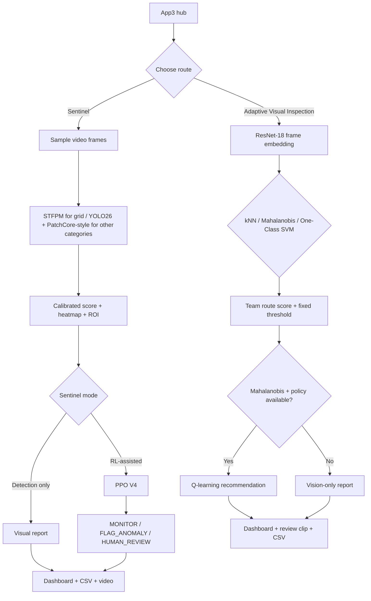

# MVTec Adaptive Visual Inspection — Sentinel + Team Pipelines

**A shared Streamlit workspace with two independent anomaly-detection pipelines and optional reinforcement-learning inspection policies.**

The project inspects five MVTec AD object categories: **grid, zipper, hazelnut, leather, and toothbrush**. Its shared App3 hub makes two approaches available from one local Streamlit workspace:

- **Sentinel:** the existing hybrid visual detector, heatmaps, dashboards, and optional PPO V4 inspection controller.
- **Adaptive Visual Inspection:** the team's separate ResNet-18 embedding pipeline with kNN cosine distance, Mahalanobis distance, or One-Class SVM, plus an optional Q-learning scheduler for the Mahalanobis route.

The two approaches are intentionally kept separate. They use different feature representations, score distributions, thresholds, assets, and decision policies. App3 is a navigation and demonstration hub—not a fused detector.

> **Important in one sentence:** Sentinel's detector is evaluated on held-out MVTec images and PPO V4 on synthetic sequences made from those still images; the team route is a separate pipeline whose thresholds and Q-learning behavior should be interpreted using its own calibration and evaluation artifacts. Neither route is yet proof of performance on real production video.

## Contents

- [What is this project?](#what-is-this-project)
- [What can the app do?](#what-can-the-app-do)
- [How does it work?](#how-does-it-work)
- [Why did we use each model?](#why-did-we-use-each-model)
- [Why did we spend so much time on PPO?](#why-did-we-spend-so-much-time-on-ppo)
- [What does PPO V4 do?](#what-does-ppo-v4-do)
- [How does the team's Q-learning scheduler work?](#how-does-the-teams-q-learning-scheduler-work)
- [Results](#results)
- [What do the metrics mean?](#what-do-the-metrics-mean)
- [Dataset and experiment setup](#dataset-and-experiment-setup)
- [Run the app](#run-the-app)
- [Required model files](#required-model-files)
- [Using the app](#using-the-app)
- [Project notebooks](#project-notebooks)
- [Limitations and next steps](#limitations-and-next-steps)
- [References](#references)

## What is this project?

Most basic anomaly detectors answer one question: **“Does this image look unusual?”** This project explores two ways to support inspection: one route estimates visual anomaly evidence, while a second experimental route can also recommend what the inspection system should do next.

The shared app starts in `app3.py`. From there, the user can open the existing Sentinel implementation or the team's Adaptive Visual Inspection route. Both work with the same five MVTec categories, but they do **not** share or fuse their detector outputs.

### Route 1: Sentinel

Sentinel uses a hybrid detector selected by category: STFPM with a ResNet-18 teacher/student pair for `grid`, and YOLO26 global embeddings plus a PatchCore-style local patch memory for `zipper`, `hazelnut`, `leather`, and `toothbrush`. It reports calibrated anomaly scores, heatmaps, ROI-aligned evidence, and frame-level traces.

Sentinel also has an optional PPO V4 controller. It uses score history and evidence features to choose one of three actions:

| PPO V4 action | In plain English |
|---|---|
| `MONITOR` | Keep watching; do not escalate this sampled frame. |
| `FLAG_ANOMALY` | Mark the frame as suspicious so it can be inspected. |
| `HUMAN_REVIEW` | Escalate the event for a person to review. |

### Route 2: Adaptive Visual Inspection

The team route uses a separate pretrained ResNet-18 encoder to represent each sampled frame as a 512-dimensional embedding. It offers three independent anomaly-scoring methods: kNN cosine distance, Mahalanobis distance, and One-Class SVM. It also includes the team's original Q-learning scheduler, which is compatible with **Mahalanobis scores only**.

This route has its own reference bundles, fixed category-specific thresholds, calibration, outputs, and policy assets under `team_artifacts/`. It does not replace Sentinel's models or thresholds.

## What can the app do?

### Sentinel — Anomaly Detection Only

Runs Sentinel's visual detector and heatmap pipeline without loading the PPO controller. Use this mode to inspect anomaly scores, examine suspicious regions, or compare detector behavior without RL actions.

### Sentinel — RL-Assisted Inspection

Adds the trained PPO V4 controller. It considers the current score, short-term score changes, whether high scores persist, local/global evidence, previous actions, and review cooldown state. The app displays the selected action and keeps a frame-level trace.

### Adaptive Visual Inspection

The separate team route supports an uploaded video and lets users select one of three vision methods:

| Method | What it measures |
|---|---|
| **kNN cosine distance** | Distance from nearby normal-reference embeddings (`k=5`). |
| **Mahalanobis distance** | Deviation from the normal-reference embedding distribution, using Ledoit–Wolf covariance shrinkage. |
| **One-Class SVM** | An RBF One-Class SVM (`nu=0.1`), with score direction adjusted so higher values indicate greater anomaly evidence. |

The team's optional Q-learning scheduler is enabled only when Mahalanobis is selected and a compatible policy file is present. Its `expert` action is displayed as a human-review recommendation; it does not perform a real expert assessment.

### Video and reporting features

**Sentinel provides:**

- Upload a video and inspect sampled frames.
- View an annotated result video **inside the app**; the app attempts to transcode output to a browser-friendly H.264 MP4, with WebM/VP9 as a fallback.
- See a rolling anomaly-score line on the annotated video.
- View ROI-aligned heatmaps.
- Click **Create dashboard** for summary statistics, score trends, maximum/minimum score locations, high-score frames, and action counts in RL mode.
- Export a standalone HTML dashboard, frame-level CSV, and a results ZIP.

**Adaptive Visual Inspection provides:**

- Configurable frame-sampling interval and maximum number of sampled frames.
- Category and vision-method selection.
- Frame-level raw score, normalized anomaly score, fixed threshold, risk level, and NORMAL/ANOMALY prediction.
- Optional Q-learning action and recommended next step when the Mahalanobis policy is active.
- Summary metrics, including frames scored, anomalies flagged, anomaly rate, mean normalized score, and fixed threshold.
- A score timeline, an action-count view when Q-learning is used, a sampled-frame review clip, and a downloadable frame-level CSV.

The team route's review clip contains sampled frames in order with frame indices and timestamps overlaid. It is not a frame-for-frame export of the entire source video.

Both routes run inference on the computer hosting Streamlit. Neither needs to upload the input video to a remote inference service.

## How does it work?

At a high level, App3 routes the uploaded video to one of two independent inspection pipelines:



Sentinel and the team route solve related but separate tasks. Within Sentinel, the visual detector produces evidence and PPO V4 chooses an inspection action based on that evidence and recent history. In the team route, a selected ResNet-18-based detector produces its own score; the Q-learning scheduler can recommend a next step only for the supported Mahalanobis configuration.

The two routes are not cross-calibrated and their scores, thresholds, heatmaps, and policy actions should not be treated as directly interchangeable.

## Why did we use each model?

### Why use MVTec AD?

MVTec AD is a common anomaly-detection benchmark containing normal product images and defective examples for different object and texture categories. It fits the question we wanted to study: can a model learn what normal looks like and identify deviations without needing thousands of labelled examples for every defect type?

This project uses five categories: `grid`, `zipper`, `hazelnut`, `leather`, and `toothbrush`.

### Why not force one detector to handle every category?

The experiments showed that the same detector did not perform equally well on every category. A repeated texture like **grid** presents a different problem from a three-dimensional object like a **hazelnut** or a **toothbrush**. The project therefore uses a **hybrid detector**: STFPM for grid, and YOLO26 global embeddings with a PatchCore-style local patch memory for the other four categories.

This category routing is based on the notebook's held-out development comparisons. It is not meant to claim that one model is universally best for all products.


### Why does the team route use ResNet-18 embeddings?

The Adaptive Visual Inspection route is a separate implementation using a pretrained ResNet-18 encoder. Each sampled frame is represented as a 512-dimensional feature vector. The pipeline then applies one selected anomaly-scoring method to compare the embedding with category-specific normal-reference data.

| Method | How it works |
|---|---|
| **kNN cosine distance** | Compares an embedding with nearby normal-reference embeddings using cosine distance (`k=5`). |
| **Mahalanobis distance** | Measures deviation from the normal-reference distribution with Ledoit–Wolf covariance shrinkage. |
| **One-Class SVM** | Learns a boundary around normal embeddings with an RBF kernel (`nu=0.1`); larger reported scores indicate more anomaly evidence. |

Each method has a fixed, category-specific cutoff derived from the 95th percentile of its cross-validated normal-reference scores. Scores are normalized empirically against the corresponding normal-reference score distribution. Users can see the raw cutoff and normalized threshold in the dashboard, but cannot adjust them there.

These are selectable alternatives, not an ensemble: the team route does not average the three methods into a single detector.

### Why STFPM for grid?

Grid is a repeated texture. STFPM compares features from a fixed teacher network and a student network trained on normal images. The idea is simple: the student learns to reproduce normal feature patterns; unusual texture regions produce larger feature differences.

The implementation uses a ResNet-18 teacher/student pair, trained on defect-free `grid/train/good` images. It can produce a spatial anomaly map that helps show **where** the texture looks different. In the recorded experiment, STFPM was selected for the grid category because its held-out results were much stronger than the YOLO26 + PatchCore-style baseline for grid.

### Why YOLO26?

In this project, **YOLO26 is used as a feature/embedding extractor for anomaly scoring and as a baseline feature source for subtype classification**. Do not read that as “YOLO26 directly draws defect bounding boxes” in the current anomaly-scoring pipeline.

A global embedding gives a compact representation of the image. The project uses it as one source of evidence for zipper, hazelnut, leather, and toothbrush. Global features are useful for the overall appearance of an image, but by themselves they can miss small defects.

### Why add PatchCore-style local patch features?

A defect may occupy only a small part of a product. A single whole-image embedding can overlook it. The PatchCore-style component extracts local features using Wide-ResNet and compares patches against a reference memory built from normal training images. Patches that do not look like the normal reference can contribute stronger local anomaly evidence.

The YOLO26 global score and local patch evidence complement each other. Scores are calibrated using category-specific normal-reference values so the reported score is easier to interpret across sampled images.

### Why DINOv2?

DINOv2 is used for a related but different task: **classifying the defect subtype when labelled defect examples exist**. For example, subtype classification may distinguish one known defect class from another. The experiment uses DINOv2 embeddings with a Linear SVM and compares them with a YOLO26-embedding + Linear SVM baseline.

The notebook's cross-category results were substantially better with DINOv2 features. Toothbrush is excluded from this subtype comparison because its dataset has one aggregate defect class rather than multiple subtypes to classify.

DINOv2 is an experimental subtype-classification branch; it should not be confused with the visual anomaly score or the PPO action selector.

### Why include a Temporal Transformer?

A single frame cannot tell the whole story. A score that suddenly rises, or remains high for several seconds, may deserve a different response from one isolated high-scoring frame. The main notebook experiments with a causal Temporal Transformer on score/evidence sequences to estimate anomaly likelihood using recent history.

That experiment is evaluated on **synthetic sequences assembled from MVTec still images**. It demonstrates a way to test temporal modelling; it does not mean MVTec provides real timestamped factory footage.

In the current app's PPO V4 integration, the Transformer probability is shown as context and is **not an input to PPO V4's action decision**. PPO V4 uses its own 20-feature observation constructed from the detector score, temporal score statistics, evidence features, past action history, and cooldown state.

---

## Why did we spend so much time on PPO?

Because **detecting an anomaly and deciding what to do next are not the same problem**.

A threshold rule can say “flag every frame whose score is above 0.95.” It cannot naturally balance all of these goals at once:

- Catch as many real anomalies as possible.
- Avoid flagging normal frames unnecessarily.
- Keep monitoring when evidence is weak or isolated.
- Escalate a meaningful event to a human reviewer.
- Avoid repeatedly escalating every adjacent frame of the same event.

We wanted the controller to learn a policy rather than simply add a hardcoded `if score > ...: HUMAN_REVIEW` rule on top of an older PPO. The policy's observation includes score changes, short rolling statistics, local/global evidence, persistence and sharp-rise signals, previous actions, and cooldown state. Its reward design trades off missed anomalies, false flags, unnecessary reviews, and useful escalation.

### Why was the first PPO not enough?

The first PPO experiment showed that a policy can learn to flag anomalies, but its raw version produced **zero human-review actions** on the evaluated synthetic sequences. Adding a rule-based surge guardrail could produce review events, but that meant the guardrail—not the policy alone—was deciding when to escalate.

The standalone PPO work therefore focused on a fresh policy that could choose `MONITOR`, `FLAG_ANOMALY`, and `HUMAN_REVIEW` itself. It took multiple versions because improving recall while keeping precision and review behaviour sensible required testing different reward settings, temporal features, and validation choices.

### What changed in V4?

PPO V4 was trained as a fresh controller and selected with recall in mind. It improved the fraction of anomalous frames receiving an intervention, while accepting a precision trade-off. Its improved recall mostly comes from assigning fewer anomalous frames to `MONITOR` and more to `FLAG_ANOMALY`; the human-review event count stayed the same as V3 in the reported held-out comparison.

That distinction matters: **V4 improved anomaly detection/triage recall; it did not increase the number of human-review events in that comparison**. The existing review events were highly concentrated on actual anomalies, but the absolute number is modest and needs additional validation.

---

## What does PPO V4 do?

The current preferred checkpoint is:

```text
models/ppo_monitor_flag_escalate_recall_v4toothbrush.zip
```

PPO V4 receives a 20-feature state built from signals such as:

- Current anomaly score.
- Change from the last score and change over a short recent window.
- Recent score mean and spread.
- Fraction of recent frames above the high-score threshold.
- Length of the current high-score run.
- Sharp-rise and persistent-high indicators.
- Calibrated local and global evidence percentiles, their dispersion, and maximum evidence.
- Previous action, recent flag rate, and review cooldown state.

It then selects one action from `MONITOR`, `FLAG_ANOMALY`, and `HUMAN_REVIEW`. The app does not add a hardcoded review override when V4 is active. Review events are counted with cooldown awareness, so the number of review **events** can be smaller than the number of frames carrying a `HUMAN_REVIEW` action.

The V4-toothbrush checkpoint uses a revised path-disjoint fit/development split intended to ensure the toothbrush category has at least a small number of source images in both partitions. Its development set is still small, especially for toothbrush, so results by individual category should be treated cautiously.

---

## How does the team's Q-learning scheduler work?

The team route contains a separate Q-learning scheduler built for the original Step 2 experiment. It is not the same policy as Sentinel's PPO V4 controller.

- **Input method:** Mahalanobis scores only. The supplied Step 2 workflow filters for Mahalanobis results; the policy is not applied to kNN or One-Class SVM.
- **State:** `(category, risk_level)`, where risk level is derived from the normalized score's margin around the normalized threshold.
- **Actions:** `skip`, `prediction`, and `expert`.
- **Reward setup:** Uses the Step 2 notebook's action costs and missed-defect / false-rejection penalties.

The dashboard enables Q-learning only when Mahalanobis is selected and a compatible policy asset is available. At runtime, `expert` is described as a **human-review recommendation**. The offline notebook's assumption of a perfect expert is a simulation assumption, not an automated expert prediction.

Sentinel's PPO V4 uses its own 20-feature observation and outputs `MONITOR`, `FLAG_ANOMALY`, or `HUMAN_REVIEW`. The two policies have different state/action definitions and must remain separate.

## Results

The tables below come from the recorded Sentinel notebook outputs. They are **not all the same experiment**: detector metrics are measured on held-out images, while temporal and PPO metrics are calculated over synthetic sequences. Read the dataset size and evaluation notes with every table. The App3 integration description supplied for the team route documents its methods and runtime behavior but does not include a comparable numerical result table, so this README does not invent performance numbers for that route.

### 1. Hybrid anomaly detector — held-out MVTec images

The main notebook tested 353 held-out images across the five categories. The selected detector was STFPM for grid and YOLO26 + PatchCore-style k-NN for the other four categories.

| Category | Selected detector | Held-out images | AUROC | Average precision (AP) |
|---|---|---:|---:|---:|
| Grid | STFPM — ResNet-18 | 55 | 93.17% | 97.49% |
| Zipper | YOLO26 + PatchCore-style k-NN | 105 | 92.83% | 97.42% |
| Hazelnut | YOLO26 + PatchCore-style k-NN | 78 | 97.79% | 98.42% |
| Leather | YOLO26 + PatchCore-style k-NN | 86 | 98.86% | 99.26% |
| Toothbrush | YOLO26 + PatchCore-style k-NN | 29 | 99.70% | 99.78% |
| **Five-category macro average** | **Hybrid route** | **353 total** | **96.47%** | **98.48%** |

For context, the legacy YOLO26 + PatchCore-style detector had a five-category macro AUROC of **92.47%** and macro AP of **96.06%** in the same notebook run. The main benefit of routing in this experiment came from grid: STFPM reached **93.17% AUROC / 97.49% AP** on grid, compared with **73.17% AUROC / 85.42% AP** for the legacy detector on that category.

These numbers describe the saved run, not a promise that every future video or camera will achieve the same performance. The held-out count for toothbrush is only 29 images, so that category's score is especially sensitive to individual examples.

### 2. Defect-subtype classification — DINOv2 vs YOLO26 embeddings

This is a separate supervised task from anomaly detection. Both approaches use a Linear SVM; the features differ. These scores are category-macro averages over four categories: grid, hazelnut, leather, and zipper. Toothbrush is excluded because it has only one aggregate defect subtype in this dataset setup.

| Method | Macro accuracy | Macro F1 | Macro balanced accuracy |
|---|---:|---:|---:|
| YOLO26 embeddings + Linear SVM | 49.37% | 47.94% | 49.21% |
| **DINOv2 ViT-S/14 + Linear SVM** | **78.32%** | **79.12%** | **79.17%** |

The result supports using DINOv2 features when the task is to distinguish known defect subtypes. Evaluation samples per category were limited, so these numbers should be confirmed on more labelled examples before relying on them in a production workflow.

### 3. Temporal Transformer experiment — synthetic sequences

The main notebook evaluated the Temporal Transformer on **7,680 synthetic held-out frames**, with an anomaly fraction of 54.51%. At probability threshold 0.5, the recorded results were:

| Metric | Result |
|---|---:|
| Frame AUROC | 96.37% |
| Average precision | 96.29% |
| Precision at 0.5 | 93.78% |
| Recall at 0.5 | 90.04% |
| F1 at 0.5 | 91.87% |
| Balanced accuracy at 0.5 | 91.44% |

These are results for the **Temporal Transformer experiment**, not PPO V4. The sequences were assembled from still images. This is a useful controlled test, but it is not a real-video benchmark.

### 4. PPO V4 — held-out synthetic sequence comparison

The table below is the main controller result to use when discussing the **current PPO V4 checkpoint**, not the older PPO results printed in the main notebook. It covers **11,520 synthetic frames** with a ground-truth anomaly fraction of 32.8% in the V4-toothbrush run.

| Policy | Precision | Recall | F1 | Balanced accuracy | Specificity | Monitor rate | Flag rate | Review events | Review-event precision | False review events on normal frames |
|---|---:|---:|---:|---:|---:|---:|---:|---:|---:|---:|
| Score-threshold baseline | 96.60% | 76.03% | 85.09% | 87.36% | 98.70% | 74.18% | 25.82% | 0 | — | 0 |
| PPO V3 baseline | 96.16% | 78.80% | 86.62% | 88.63% | 98.46% | 73.12% | 24.58% | 173 | 96.53% | 6 |
| **PPO V4-toothbrush (current)** | **93.50%** | **89.79%** | **91.60%** | **93.37%** | **96.95%** | **68.50%** | **29.72%** | **173** | **96.53%** | **6** |

`Monitor rate` and `flag rate` are percentages of evaluated frames. Human-review events are cooldown-aware event counts, not necessarily the number of frames labelled `HUMAN_REVIEW`.

**What did V4 improve?** Versus the score-threshold baseline, recall increased from **76.03% to 89.79%** (+13.76 percentage points), F1 increased from **85.09% to 91.60%** (+6.51 points), and balanced accuracy increased from **87.36% to 93.37%** (+6.01 points). Precision decreased from **96.60% to 93.50%** (−3.10 points). Versus PPO V3, V4 increased recall by **10.99 points** and F1 by **4.98 points**, with a precision decrease of **2.66 points**.

In the same comparison, the 173 review events had **96.53% event precision**, with **6 false review events on normal frames**. These review-event counts and results come from synthetic replay, not a live production video stream.

One training detail worth noting: in the V4-toothbrush development run, no candidate met the requested 98% development-precision floor. The script selected the highest development F2 candidate and then evaluated it on the held-out set. The held-out V4 precision is therefore **not** 98%, and the README does not present it as such.

### 5. Adaptive Visual Inspection route

The team route exposes three independent ResNet-18-based detectors and an optional Mahalanobis-conditioned Q-learning scheduler. Its fixed category thresholds are derived from the 95th percentile of cross-validated normal-reference scores. The source integration README does not provide held-out AUROC/AP or thresholded precision/recall tables for this branch, so no such results are reported here.

The team route's thresholds and normalized scores belong to its own reference distribution. They should not be compared numerically with Sentinel's ECDF scores or PPO results. To make a fair empirical comparison, run both routes on the same category and aligned sampled frames, then compare frame-level NORMAL/ANOMALY outcomes against the same ground-truth labels where available.

---

## What do the metrics mean?

| Metric | Simple meaning |
|---|---|
| **AUROC** | How well scores tend to rank anomalous images above normal images across different thresholds. It is not the accuracy at one chosen threshold. |
| **Average precision (AP)** | A summary of precision/recall behaviour across thresholds. It is affected by how many anomalies are in the evaluated set. |
| **Precision** | Of the frames the policy treated as positive/intervened on, how many were actually anomalous? |
| **Recall** | Of all anomalous frames, how many received a positive intervention (`FLAG_ANOMALY` or `HUMAN_REVIEW`)? |
| **F1** | A single score balancing precision and recall. |
| **Balanced accuracy** | The average of sensitivity/recall and specificity, helping show behaviour on both normal and anomalous frames. |
| **Specificity** | How often normal frames were correctly left as non-positive. |
| **Review-event precision** | Of the distinct human-review events, how many landed on anomalous frames? This is not the same as recall of all anomalies. |

### Is an anomaly score of 0.95 a 95% chance of a defect?

**No.** In this app, the score is an empirical percentile relative to saved normal-reference calibration scores. A score near `0.95` means the image's score is around or above the 95th percentile of that normal calibration reference. It is **not** a calibrated 95% probability that the item is defective.

The selected high-anomaly threshold is used to highlight and summarize frames in the app; it should not be read as a model confidence probability.

The Adaptive Visual Inspection route also normalizes scores empirically against its own normal-reference distribution. Its raw and normalized values have a different construction from Sentinel's scores; the same numeric value does not guarantee the same anomaly severity across the two routes.

---

## Dataset and experiment setup

The notebook run reported **1,705 images** across the selected five categories: 1,200 normal training images and 505 test images. The notebook split the test images into 152 controller-development images and 353 held-out evaluation images. Detector training uses defect-free training images; the test images are used for evaluation and for building controlled temporal experiments, not as extra normal training images.

| Category | Normal training images (`train/good`) | Held-out test images in detector table |
|---|---:|---:|
| Grid | 264 | 55 |
| Zipper | 240 | 105 |
| Hazelnut | 391 | 78 |
| Leather | 245 | 86 |
| Toothbrush | 60 | 29 |
| **Total** | **1,200** | **353** |

The remainder of the 505 test images formed the 152-image controller-development partition. Counts may differ if you download another dataset revision or recreate the split with different code/settings.


The Adaptive Visual Inspection route uses the same five object categories but has its own ResNet-18 embedding-reference workflow and its own cross-validated normal-reference score distributions. Its Colab asset builder exports these reference bundles and policy-related artifacts separately from Sentinel. The exported references support local inference without keeping the full MVTec dataset on the PC.
### Why do we keep saying “synthetic sequence”?

MVTec AD is an **image dataset**, not a dataset of continuous factory videos with real time stamps. To test a sequential policy, images and their scores were arranged into controlled sequences, such as sudden score spikes or persistent high scores. This lets us test score-history features, action timing, and cooldown behaviour, but it does not reproduce every property of real video: motion blur, lighting changes, camera movement, object tracking, or true defect onset over time.

The demonstration human-review clip is also built from MVTec still images. It is a replayable example of a PPO V4 decision, not captured factory footage.

---

## Run the app

### 1. Get the files

Use the integrated project layout shown in the next section. The shared entry point is `app3.py`. Keep the existing Sentinel files (`app2.py`, `inference2.py`, `models/`, and `assets/`) intact while adding the team route files and `team_artifacts/`.

### 2. Create a Python environment

Python **3.11 or 3.12** is recommended. On Windows PowerShell, from the project root:

```powershell
py -3.12 -m venv .venv
.\.venv\Scripts\Activate.ps1
python -m pip install --upgrade pip
```

If you use an NVIDIA GPU, install a PyTorch/torchvision build that matches your CUDA setup using the [official PyTorch installation selector](https://pytorch.org/get-started/locally/) before installing the remaining requirements.

Install the required packages if they are not already present:

```powershell
python -m pip install streamlit torch torchvision opencv-python numpy pandas pillow scikit-learn
```

For browser-compatible MP4 review-clip export, `imageio-ffmpeg` may also be useful:

```powershell
python -m pip install imageio-ffmpeg
```

Avoid reinstalling packages unnecessarily if Sentinel already runs in the environment.

### 3. Prepare the team's assets

1. Open `colab_asset_builder.ipynb` in Google Colab.
2. Select a GPU runtime if available.
3. Run the notebook from top to bottom to build and export the team reference and policy artifacts.
4. Download `MVTec_Team_Assets.zip` and extract it into the project root beside `app3.py`.

The asset bundle contains the team route's reference assets; it does not package the complete MVTec dataset. Once the assets are extracted, local inference for the team route does not require the full dataset on the PC.

### 4. Launch App3

From the project root with the virtual environment active:

```powershell
python -m streamlit run app3.py
```

Open the local address printed by Streamlit. Choose **Open Sentinel** for the existing Sentinel implementation or **Open Adaptive Inspection** for the team's separate route.

### 5. Point Sentinel to its model project

Sentinel uses this default:

```python
default_project = os.environ.get("MVTEC_PROJECT_DIR", str(Path.cwd()))
```

If `MVTEC_PROJECT_DIR` is not set, it looks in the current working directory. Set it to the folder that contains Sentinel's `models/` and `assets/` folders if needed:

```powershell
$env:MVTEC_PROJECT_DIR = "C:\path\to\MVTec_RL_Anomaly_Project"
python -m streamlit run app3.py
```

Replace the example path with your actual project path. The team route uses its separate `team_artifacts/` directory.

## Required model files

The integrated project has two model/asset areas. **Sentinel's assets remain separate from the team's assets.** Do not replace one route's calibration files, reference banks, or policy with the other route's files.

Expected layout inside the project root:

```text
your_project/
├── app3.py                              # Shared App3 hub
├── app2.py                              # Existing Sentinel app — preserve
├── inference2.py                        # Existing Sentinel inference — preserve
├── team_inference.py                    # Team's separate ResNet-18 pipeline
├── rebuild_mahalanobis_policy.py        # Optional team Q-policy rebuild helper
├── colab_asset_builder.ipynb             # Team asset-export workflow
├── pages/
│   ├── 01_Sentinel.py                   # Navigation adapter to Sentinel
│   └── 02_Adaptive_Inspection.py        # Team vision + Q-learning route
├── models/                              # Sentinel model weights and memory banks
│   ├── yolo26n.pt
│   ├── wide_resnet50_2_patch_extractor.pth
│   ├── stfpm_teacher_resnet18_grid.pth
│   ├── stfpm_student_resnet18_grid.pth
│   ├── yolo26_embedding_knn_<category>.joblib
│   ├── patchcore_patch_bank_<category>.pt
│   ├── causal_temporal_transformer.pt
│   ├── temporal_transformer_input_scaler.joblib
│   ├── ppo_monitor_flag_escalate_recall_v4toothbrush.zip
│   └── ppo_inspection_policy.zip         # Optional legacy fallback
├── assets/                              # Sentinel calibration and config
│   ├── calibration_<category>.npz
│   ├── stfpm_calibration_grid.npz
│   └── decision_thresholds.json          # Optional per-category override
└── team_artifacts/                      # Team route assets; separate from Sentinel
    ├── asset_manifest.json
    ├── vision/
    │   ├── resnet18_imagenet1k_v1.pth
    │   ├── reference_grid.npz
    │   ├── reference_zipper.npz
    │   ├── reference_hazelnut.npz
    │   ├── reference_leather.npz
    │   ├── reference_toothbrush.npz
    │   └── vision_asset_summary.csv
    ├── outputs/
    │   └── vision/
    │       └── current_anomaly_score.csv
    └── rl/
        ├── shared_q_policy.json
        └── heldout_policy_decisions.csv
```

The `<category>` name is one of `grid`, `zipper`, `hazelnut`, `leather`, or `toothbrush`. Exact Sentinel filenames must match the files exported by the main notebook/model bundle.

The team asset builder exports the ResNet-18 weights, category-specific normal-reference bundles, calibration information, score output used by the policy helper, and shared Q-learning policy. The `current_anomaly_score.csv` file is needed only if you want to rebuild the shared policy with `rebuild_mahalanobis_policy.py`. The asset builder may also export audit and manifest files; keep those with `team_artifacts/`.

**Large assets are not part of the source-code README.** Keep model weights and MVTec data outside the Git source history or use an appropriate large-file/release workflow. Do not commit Kaggle tokens or credentials.

Sentinel detection-only mode does not need its PPO or Transformer assets, but it still needs Sentinel's visual detector assets. Sentinel RL-assisted mode needs the PPO V4 checkpoint for V4; if it is missing, the app may use the legacy policy and show a warning. The team Q-learning route needs its own `team_artifacts/` references and compatible policy file.

## Using the app

### Sentinel route

1. Start App3 and choose **Open Sentinel**.
2. Choose **Anomaly Detection Only** or **RL-Assisted Inspection**.
3. Select the category that matches the product in the video. The detector is category-specific.
4. Choose the ROI mode and high-anomaly reporting threshold.
5. Upload a video (for example MP4, MOV, AVI, or MKV) and click **Inspect this video**.
6. Inspect the annotated video, score trace, heatmap, frame table, and—if RL mode is enabled—the PPO action trace.
7. Click **Create dashboard** to generate run statistics and action summaries. Export the CSV, standalone HTML dashboard, or complete results ZIP as needed.

### Adaptive Visual Inspection route

1. Choose **Open Adaptive Inspection** from App3 or Streamlit's page selector.
2. Select the product category and one of the three vision methods: kNN cosine distance, Mahalanobis distance, or One-Class SVM.
3. Upload the inspection video and set the sampling interval and maximum number of sampled frames.
4. Review raw and normalized scores, the fixed threshold, risk level, and NORMAL/ANOMALY predictions.
5. The Q-learning action and recommended next step are available only when Mahalanobis is selected and a compatible policy is present.
6. Review the score timeline and action counts, then download the frame-level CSV or sampled-frame review clip.

### What do the dashboards report?

Sentinel can report the number of sampled and high-score frames, average/minimum/maximum scores, timestamps for score extremes, top-scoring frames, score distributions, and PPO actions/events in RL mode.

The team route reports frames scored, anomalies flagged, anomaly rate, mean normalized score, its fixed threshold, and—when Q-learning is enabled—the action distribution. It also provides the sampled-frame review clip and CSV.

### Why can't the two score charts be compared directly?

The pipelines use different feature representations and independent normal-reference distributions. Their raw scores, normalized scores, thresholds, heatmaps/localization outputs, and RL actions have different meanings. A careful comparison should use the same category, aligned sampled frames, and consistent ground-truth labels, then compare frame-level NORMAL/ANOMALY outcomes.

### Why might an exported video fail to play in a browser?

Browser support depends on the codec, not only the `.mp4` extension. Sentinel attempts to transcode its annotated result to H.264 MP4 and then WebM/VP9 if needed. The team route's sampled-frame review clip is a separate output. If playback fails, install `imageio-ffmpeg`, restart Streamlit, and check the message shown near the video.

## Project notebooks

The notebooks preserve different stages of the investigation. Their outputs are included for reproducibility; not every model inside every notebook is the model currently selected by the app.

| Notebook | What it is for | What to treat as current |
|---|---|---|
| `MVTEC_FINAL.ipynb` | Main hybrid experiment: category routing, detector evaluation, DINOv2 subtype classification, Temporal Transformer experiment, historical PPO comparison, heatmaps, GIFs, and example clips. | Use its hybrid-detector and DINOv2 tables as reported above. **Do not use its older PPO table as the current controller result.** |
| `PPO_Standalone_Monitor_Flag_Escalate_v3.ipynb` | Standalone PPO training and policy comparison work. The notebook filename reflects an earlier version and may contain later V4-toothbrush training/evaluation cells. | The current app's preferred checkpoint is `ppo_monitor_flag_escalate_recall_v4toothbrush.zip`; use the V4-toothbrush row in the PPO table above. |
| `PPO_RecallBalanced_v4toothbrush_Cell.ipynb` | The self-contained V4-toothbrush training cell with the path-disjoint fit/development split and new output names. | This is the clearest entry point for understanding the current V4 checkpoint if you are including it in the repository. |
| `MVTec_PPO_HumanReview_Clip_OneCell.ipynb` | Replays held-out synthetic sequences with the V4 checkpoint and exports an annotated clip and trace containing a learned `HUMAN_REVIEW` action. | Use it as an example/replay utility, not as the training notebook. |
| `colab_asset_builder.ipynb` | Builds and exports the separate team's ResNet-18 reference, calibration, score-output, and Q-policy assets. | Use it to create `MVTec_Team_Assets.zip` for the Adaptive Visual Inspection route. |
| Team's original Step 2 Q-learning notebook | The source workflow for the shared Mahalanobis-conditioned policy, its state/action definition, and reward setup. | Keep the policy input method consistent with Mahalanobis; the scheduler is not intended for kNN or One-Class SVM scores. |
| `rebuild_mahalanobis_policy.py` | Optional local helper that rebuilds the Step 2-compatible policy from `team_artifacts/outputs/vision/current_anomaly_score.csv`. | Use only when the expected score file exists; the helper writes team policy/audit outputs under `team_artifacts/`. |

If you rename the notebooks before committing them, update the paths in this table.

### Important note about the notebook names

The name `MVTEC_FINAL` does not mean every checkpoint in it is the one used by the app now. That notebook contains earlier PPO experiments for historical comparison. The **current Sentinel policy is V4-toothbrush**. The team route has its own Q-learning policy, stored under `team_artifacts/rl/`, and it is used only with the Mahalanobis vision method. The main notebook remains useful because it documents Sentinel's detector choice, feature experiments, subtype results, and earlier temporal modelling work.

---

## Limitations and next steps

This project is a research prototype. The current evidence is encouraging, but a few limitations need to be stated plainly:

1. **Synthetic time, not real time.** PPO V4 was evaluated on sequences made by arranging MVTec still-image scores. Real labelled video evaluation is the most important next step.
2. **Small held-out categories.** In the detector table, held-out sample counts vary by category and toothbrush has only 29 images. More data is needed to establish stable per-category performance.
3. **Precision/recall trade-off.** V4 raises recall but lowers precision compared with the score-threshold baseline. A production system must choose the trade-off based on the cost of a missed defect versus an unnecessary inspection.
4. **Human-review coverage is not complete.** High review-event precision does not mean every severe anomaly is sent to a human. Review recall in the reported PPO comparison is much lower than review precision; the event policy needs further tuning and real-video validation.
5. **Scores are percentiles, not probabilities.** Treat thresholds as calibrated ranking/reporting values, not estimated probabilities of a defect.
6. **Camera/domain shift.** MVTec product images are controlled and tightly framed. Real cameras introduce changing light, focus, perspective, motion blur, backgrounds, and product positioning.
7. **The detector is category-specific.** Select the category matching the item being inspected. This project is not a universal open-world detector for arbitrary products.
8. **Large assets are separate.** Model weights and data are not necessarily included in the GitHub source. Follow the asset layout above and keep credentials out of the repository.
9. **The team route has its own threshold calibration.** Its cutoffs are fixed from its own normal-reference scores and must not be substituted for Sentinel's category thresholds.
10. **The team Q-learning policy is method-specific.** It is trained for Mahalanobis score inputs and should not be used with kNN or One-Class SVM.
11. **The team route's perfect-expert assumption is simulated.** The runtime `expert` action is a human-review recommendation, not an automated expert judgement.
12. **The two pipelines remain independent.** Do not directly rank their scores or combine their actions without a dedicated cross-evaluation on aligned frames and shared ground truth.

### What should we do next?

- Collect labelled, continuous video and preserve real timestamps and defect intervals.
- Evaluate by category, defect type, and video—not only by sampled frame.
- Report false alarms per minute/video and the delay from anomaly onset to flag/review.
- Tune the recall/precision and review workload on a development set before a final held-out evaluation.
- Add reviewer feedback and a clear process for acknowledging or rejecting a `HUMAN_REVIEW` event.
- Compare the deployed model bundle and checkpoint filenames against the README after each retraining run.

---

## References

- [MVTec AD dataset](https://www.mvtec.com/company/research/datasets/mvtec-ad) — normal and defective industrial inspection images.
- [STFPM paper](https://arxiv.org/abs/2103.04257) — student–teacher feature matching for anomaly detection.
- [DINOv2 official repository](https://github.com/facebookresearch/dinov2) — pretrained visual feature representations.
- [PatchCore paper](https://arxiv.org/abs/2106.08265) — local patch memory for industrial anomaly detection; this project uses a PatchCore-style approach, not necessarily the authors' exact reference implementation.
- [Ultralytics documentation](https://docs.ultralytics.com/) — YOLO model tooling used for feature extraction in this project.
- [Stable-Baselines3 PPO documentation](https://stable-baselines3.readthedocs.io/en/master/modules/ppo.html) — PPO implementation used to train the inspection controller.
- [PyTorch installation guide](https://pytorch.org/get-started/locally/) — installing a compatible CPU/GPU build.

---

## Final takeaway

The integrated project offers one App3 entry point with two independent inspection approaches. Sentinel combines a category-routed visual detector, heatmaps, dashboards, and an optional PPO V4 controller that can `MONITOR`, `FLAG_ANOMALY`, or `HUMAN_REVIEW`. The Adaptive Visual Inspection route adds three ResNet-18-based anomaly-scoring options and a separate Mahalanobis-conditioned Q-learning recommendation layer.

The reported Sentinel result is that **PPO V4 improved recall on the synthetic held-out sequence evaluation**, with a precision trade-off. The two approaches are not fused: their models, calibration assets, thresholds, and policies remain separate. The next milestone is to validate both approaches on real, continuously recorded inspection video and compare them on aligned frames with shared ground truth.
