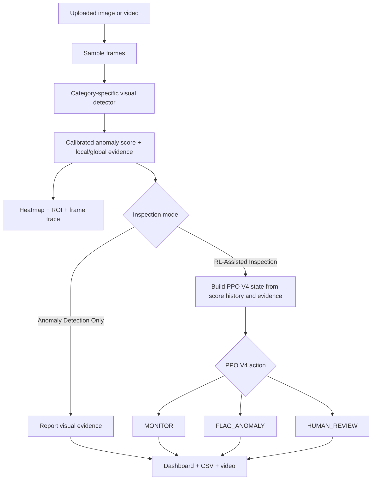

# Sentinel — MVTec Anomaly Inspection Studio

**A visual anomaly detector with an optional reinforcement-learning inspection controller.**

Sentinel looks for defects in five MVTec AD object categories: **grid, zipper, hazelnut, leather, and toothbrush**. It can inspect a video frame by frame, show where unusual visual evidence appears, track anomaly scores, and—when RL mode is selected—ask a trained PPO policy whether to keep monitoring, flag a frame, or send it for human review.

This README explains the project in plain English: what each part does, why we used it, what worked, how to run the app, and what the results do (and do not) prove.

> **Important in one sentence:** the image detector is evaluated on held-out MVTec images; the PPO V4 controller is evaluated on synthetic sequences made from those still images. The PPO results are useful evidence for the experiment, but they are not yet proof of performance on real production video.

---

## Contents

- [What is this project?](#what-is-this-project)
- [What can the app do?](#what-can-the-app-do)
- [How does it work?](#how-does-it-work)
- [Why did we use each model?](#why-did-we-use-each-model)
- [Why did we spend so much time on PPO?](#why-did-we-spend-so-much-time-on-ppo)
- [What does PPO V4 do?](#what-does-ppo-v4-do)
- [Results](#results)
- [What do the metrics mean?](#what-do-the-metrics-mean)
- [Dataset and experiment setup](#dataset-and-experiment-setup)
- [Run the app](#run-the-app)
- [Required model files](#required-model-files)
- [Using the app](#using-the-app)
- [Project notebooks](#project-notebooks)
- [Limitations and next steps](#limitations-and-next-steps)
- [References](#references)

---

## What is this project?

Most basic anomaly detectors answer one question: **“Does this image look unusual?”** Sentinel tries to support the next question too: **“What should the inspection system do about it?”**

The visual part compares an inspected image or video frame with reference examples of normal products. It produces a calibrated anomaly score and spatial evidence for the suspicious area. The app can show the score, heatmap, selected region of interest (ROI), and the exact frame where the score was recorded.

The optional reinforcement-learning (RL) part uses score history and other evidence to choose one of three actions:

| PPO V4 action | In plain English |
|---|---|
| `MONITOR` | Keep watching; do not escalate this sampled frame. |
| `FLAG_ANOMALY` | Mark the frame as suspicious so it can be inspected. |
| `HUMAN_REVIEW` | Escalate the event for a person to review. |

The app has two modes so the visual detector can be tested on its own or alongside the learned controller.

## What can the app do?

### Anomaly Detection Only

Runs the visual detector and heatmap pipeline without loading the PPO controller. Use this mode when you want to inspect anomaly scores, examine the suspicious region, or compare how the detector behaves without RL actions.

### RL-Assisted Inspection

Adds the trained PPO V4 controller. It considers the current score, short-term score changes, whether high scores persist, local/global evidence, previous actions, and review cooldown state. The app displays the selected action and keeps a frame-level trace.

### Video and reporting features

- Upload a video and inspect sampled frames.
- View an annotated result video **inside the app**; the app attempts to transcode output to a browser-friendly H.264 MP4, with WebM/VP9 as a fallback.
- See a rolling anomaly-score line on the annotated video.
- View ROI-aligned heatmaps.
- Click **Create dashboard** for summary statistics, score trends, maximum/minimum score locations, high-score frames, and action counts in RL mode.
- Export a standalone HTML dashboard, frame-level CSV, and a results ZIP.

The app performs inference on the computer running Streamlit. It does not need to upload your video to a remote inference service.

## How does it work?

At a high level:



The visual detector and PPO solve different jobs. The detector produces evidence; PPO chooses an inspection action based on the evidence and recent history.

---

## Why did we use each model?

### Why use MVTec AD?

MVTec AD is a common anomaly-detection benchmark containing normal product images and defective examples for different object and texture categories. It fits the question we wanted to study: can a model learn what normal looks like and identify deviations without needing thousands of labelled examples for every defect type?

This project uses five categories: `grid`, `zipper`, `hazelnut`, `leather`, and `toothbrush`.

### Why not force one detector to handle every category?

The experiments showed that the same detector did not perform equally well on every category. A repeated texture like **grid** presents a different problem from a three-dimensional object like a **hazelnut** or a **toothbrush**. The project therefore uses a **hybrid detector**: STFPM for grid, and YOLO26 global embeddings with a PatchCore-style local patch memory for the other four categories.

This category routing is based on the notebook's held-out development comparisons. It is not meant to claim that one model is universally best for all products.

### Why STFPM for grid?

Grid is a repeated texture. STFPM compares features from a fixed teacher network and a student network trained on normal images. The idea is simple: the student learns to reproduce normal feature patterns; unusual texture regions produce larger feature differences.

The implementation uses a ResNet-18 teacher/student pair, trained on defect-free `grid/train/good` images. It can produce a spatial anomaly map that helps show **where** the texture looks different. In the recorded experiment, STFPM was selected for the grid category because its held-out results were much stronger than the YOLO26 + PatchCore-style baseline for grid.

### Why YOLO26?

In this project, **YOLO26 is used as a feature/embedding extractor for anomaly scoring and as a baseline feature source for subtype classification**. Do not read that as “YOLO26 directly draws defect bounding boxes” in the current anomaly-scoring pipeline.

A global embedding gives a compact representation of the image. The project uses it as one source of evidence for zipper, hazelnut, leather, and toothbrush. Global features are useful for the overall appearance of an image, but by themselves they can miss small defects.

### Why add PatchCore-style local patch features?

A defect may occupy only a small part of a product. A single whole-image embedding can overlook it. The PatchCore-style component extracts local features using Wide-ResNet and compares patches against a reference memory built from normal training images. Patches that do not look like the normal reference can contribute stronger local anomaly evidence.

The YOLO26 global score and local patch evidence complement each other. Scores are calibrated using category-specific normal-reference values so the reported score is easier to interpret across sampled images.

### Why DINOv2?

DINOv2 is used for a related but different task: **classifying the defect subtype when labelled defect examples exist**. For example, subtype classification may distinguish one known defect class from another. The experiment uses DINOv2 embeddings with a Linear SVM and compares them with a YOLO26-embedding + Linear SVM baseline.

The notebook's cross-category results were substantially better with DINOv2 features. Toothbrush is excluded from this subtype comparison because its dataset has one aggregate defect class rather than multiple subtypes to classify.

DINOv2 is an experimental subtype-classification branch; it should not be confused with the visual anomaly score or the PPO action selector.

### Why include a Temporal Transformer?

A single frame cannot tell the whole story. A score that suddenly rises, or remains high for several seconds, may deserve a different response from one isolated high-scoring frame. The main notebook experiments with a causal Temporal Transformer on score/evidence sequences to estimate anomaly likelihood using recent history.

That experiment is evaluated on **synthetic sequences assembled from MVTec still images**. It demonstrates a way to test temporal modelling; it does not mean MVTec provides real timestamped factory footage.

In the current app's PPO V4 integration, the Transformer probability is shown as context and is **not an input to PPO V4's action decision**. PPO V4 uses its own 20-feature observation constructed from the detector score, temporal score statistics, evidence features, past action history, and cooldown state.

---

## Why did we spend so much time on PPO?

Because **detecting an anomaly and deciding what to do next are not the same problem**.

A threshold rule can say “flag every frame whose score is above 0.95.” It cannot naturally balance all of these goals at once:

- Catch as many real anomalies as possible.
- Avoid flagging normal frames unnecessarily.
- Keep monitoring when evidence is weak or isolated.
- Escalate a meaningful event to a human reviewer.
- Avoid repeatedly escalating every adjacent frame of the same event.

We wanted the controller to learn a policy rather than simply add a hardcoded `if score > ...: HUMAN_REVIEW` rule on top of an older PPO. The policy's observation includes score changes, short rolling statistics, local/global evidence, persistence and sharp-rise signals, previous actions, and cooldown state. Its reward design trades off missed anomalies, false flags, unnecessary reviews, and useful escalation.

### Why was the first PPO not enough?

The first PPO experiment showed that a policy can learn to flag anomalies, but its raw version produced **zero human-review actions** on the evaluated synthetic sequences. Adding a rule-based surge guardrail could produce review events, but that meant the guardrail—not the policy alone—was deciding when to escalate.

The standalone PPO work therefore focused on a fresh policy that could choose `MONITOR`, `FLAG_ANOMALY`, and `HUMAN_REVIEW` itself. It took multiple versions because improving recall while keeping precision and review behaviour sensible required testing different reward settings, temporal features, and validation choices.

### What changed in V4?

PPO V4 was trained as a fresh controller and selected with recall in mind. It improved the fraction of anomalous frames receiving an intervention, while accepting a precision trade-off. Its improved recall mostly comes from assigning fewer anomalous frames to `MONITOR` and more to `FLAG_ANOMALY`; the human-review event count stayed the same as V3 in the reported held-out comparison.

That distinction matters: **V4 improved anomaly detection/triage recall; it did not increase the number of human-review events in that comparison**. The existing review events were highly concentrated on actual anomalies, but the absolute number is modest and needs additional validation.

---

## What does PPO V4 do?

The current preferred checkpoint is:

```text
models/ppo_monitor_flag_escalate_recall_v4toothbrush.zip
```

PPO V4 receives a 20-feature state built from signals such as:

- Current anomaly score.
- Change from the last score and change over a short recent window.
- Recent score mean and spread.
- Fraction of recent frames above the high-score threshold.
- Length of the current high-score run.
- Sharp-rise and persistent-high indicators.
- Calibrated local and global evidence percentiles, their dispersion, and maximum evidence.
- Previous action, recent flag rate, and review cooldown state.

It then selects one action from `MONITOR`, `FLAG_ANOMALY`, and `HUMAN_REVIEW`. The app does not add a hardcoded review override when V4 is active. Review events are counted with cooldown awareness, so the number of review **events** can be smaller than the number of frames carrying a `HUMAN_REVIEW` action.

The V4-toothbrush checkpoint uses a revised path-disjoint fit/development split intended to ensure the toothbrush category has at least a small number of source images in both partitions. Its development set is still small, especially for toothbrush, so results by individual category should be treated cautiously.

---

## Results

The tables below come from the recorded notebook outputs shared with this project. They are **not all the same experiment**: detector metrics are measured on held-out images, while temporal and PPO metrics are calculated over synthetic sequences. Read the dataset size and evaluation notes with every table.

### 1. Hybrid anomaly detector — held-out MVTec images

The main notebook tested 353 held-out images across the five categories. The selected detector was STFPM for grid and YOLO26 + PatchCore-style k-NN for the other four categories.

| Category | Selected detector | Held-out images | AUROC | Average precision (AP) |
|---|---|---:|---:|---:|
| Grid | STFPM — ResNet-18 | 55 | 93.17% | 97.49% |
| Zipper | YOLO26 + PatchCore-style k-NN | 105 | 92.83% | 97.42% |
| Hazelnut | YOLO26 + PatchCore-style k-NN | 78 | 97.79% | 98.42% |
| Leather | YOLO26 + PatchCore-style k-NN | 86 | 98.86% | 99.26% |
| Toothbrush | YOLO26 + PatchCore-style k-NN | 29 | 99.70% | 99.78% |
| **Five-category macro average** | **Hybrid route** | **353 total** | **96.47%** | **98.48%** |

For context, the legacy YOLO26 + PatchCore-style detector had a five-category macro AUROC of **92.47%** and macro AP of **96.06%** in the same notebook run. The main benefit of routing in this experiment came from grid: STFPM reached **93.17% AUROC / 97.49% AP** on grid, compared with **73.17% AUROC / 85.42% AP** for the legacy detector on that category.

These numbers describe the saved run, not a promise that every future video or camera will achieve the same performance. The held-out count for toothbrush is only 29 images, so that category's score is especially sensitive to individual examples.

### 2. Defect-subtype classification — DINOv2 vs YOLO26 embeddings

This is a separate supervised task from anomaly detection. Both approaches use a Linear SVM; the features differ. These scores are category-macro averages over four categories: grid, hazelnut, leather, and zipper. Toothbrush is excluded because it has only one aggregate defect subtype in this dataset setup.

| Method | Macro accuracy | Macro F1 | Macro balanced accuracy |
|---|---:|---:|---:|
| YOLO26 embeddings + Linear SVM | 49.37% | 47.94% | 49.21% |
| **DINOv2 ViT-S/14 + Linear SVM** | **78.32%** | **79.12%** | **79.17%** |

The result supports using DINOv2 features when the task is to distinguish known defect subtypes. Evaluation samples per category were limited, so these numbers should be confirmed on more labelled examples before relying on them in a production workflow.

### 3. Temporal Transformer experiment — synthetic sequences

The main notebook evaluated the Temporal Transformer on **7,680 synthetic held-out frames**, with an anomaly fraction of 54.51%. At probability threshold 0.5, the recorded results were:

| Metric | Result |
|---|---:|
| Frame AUROC | 96.37% |
| Average precision | 96.29% |
| Precision at 0.5 | 93.78% |
| Recall at 0.5 | 90.04% |
| F1 at 0.5 | 91.87% |
| Balanced accuracy at 0.5 | 91.44% |

These are results for the **Temporal Transformer experiment**, not PPO V4. The sequences were assembled from still images. This is a useful controlled test, but it is not a real-video benchmark.

### 4. PPO V4 — held-out synthetic sequence comparison

The table below is the main controller result to use when discussing the **current PPO V4 checkpoint**, not the older PPO results printed in the main notebook. It covers **11,520 synthetic frames** with a ground-truth anomaly fraction of 32.8% in the V4-toothbrush run.

| Policy | Precision | Recall | F1 | Balanced accuracy | Specificity | Monitor rate | Flag rate | Review events | Review-event precision | False review events on normal frames |
|---|---:|---:|---:|---:|---:|---:|---:|---:|---:|---:|
| Score-threshold baseline | 96.60% | 76.03% | 85.09% | 87.36% | 98.70% | 74.18% | 25.82% | 0 | — | 0 |
| PPO V3 baseline | 96.16% | 78.80% | 86.62% | 88.63% | 98.46% | 73.12% | 24.58% | 173 | 96.53% | 6 |
| **PPO V4-toothbrush (current)** | **93.50%** | **89.79%** | **91.60%** | **93.37%** | **96.95%** | **68.50%** | **29.72%** | **173** | **96.53%** | **6** |

`Monitor rate` and `flag rate` are percentages of evaluated frames. Human-review events are cooldown-aware event counts, not necessarily the number of frames labelled `HUMAN_REVIEW`.

**What did V4 improve?** Versus the score-threshold baseline, recall increased from **76.03% to 89.79%** (+13.76 percentage points), F1 increased from **85.09% to 91.60%** (+6.51 points), and balanced accuracy increased from **87.36% to 93.37%** (+6.01 points). Precision decreased from **96.60% to 93.50%** (−3.10 points). Versus PPO V3, V4 increased recall by **10.99 points** and F1 by **4.98 points**, with a precision decrease of **2.66 points**.

In the same comparison, the 173 review events had **96.53% event precision**, with **6 false review events on normal frames**. These review-event counts and results come from synthetic replay, not a live production video stream.

One training detail worth noting: in the V4-toothbrush development run, no candidate met the requested 98% development-precision floor. The script selected the highest development F2 candidate and then evaluated it on the held-out set. The held-out V4 precision is therefore **not** 98%, and the README does not present it as such.

---

## What do the metrics mean?

| Metric | Simple meaning |
|---|---|
| **AUROC** | How well scores tend to rank anomalous images above normal images across different thresholds. It is not the accuracy at one chosen threshold. |
| **Average precision (AP)** | A summary of precision/recall behaviour across thresholds. It is affected by how many anomalies are in the evaluated set. |
| **Precision** | Of the frames the policy treated as positive/intervened on, how many were actually anomalous? |
| **Recall** | Of all anomalous frames, how many received a positive intervention (`FLAG_ANOMALY` or `HUMAN_REVIEW`)? |
| **F1** | A single score balancing precision and recall. |
| **Balanced accuracy** | The average of sensitivity/recall and specificity, helping show behaviour on both normal and anomalous frames. |
| **Specificity** | How often normal frames were correctly left as non-positive. |
| **Review-event precision** | Of the distinct human-review events, how many landed on anomalous frames? This is not the same as recall of all anomalies. |

### Is an anomaly score of 0.95 a 95% chance of a defect?

**No.** In this app, the score is an empirical percentile relative to saved normal-reference calibration scores. A score near `0.95` means the image's score is around or above the 95th percentile of that normal calibration reference. It is **not** a calibrated 95% probability that the item is defective.

The selected high-anomaly threshold is used to highlight and summarize frames in the app; it should not be read as a model confidence probability.

---

## Dataset and experiment setup

The notebook run reported **1,705 images** across the selected five categories: 1,200 normal training images and 505 test images. The notebook split the test images into 152 controller-development images and 353 held-out evaluation images. Detector training uses defect-free training images; the test images are used for evaluation and for building controlled temporal experiments, not as extra normal training images.

| Category | Normal training images (`train/good`) | Held-out test images in detector table |
|---|---:|---:|
| Grid | 264 | 55 |
| Zipper | 240 | 105 |
| Hazelnut | 391 | 78 |
| Leather | 245 | 86 |
| Toothbrush | 60 | 29 |
| **Total** | **1,200** | **353** |

The remainder of the 505 test images formed the 152-image controller-development partition. Counts may differ if you download another dataset revision or recreate the split with different code/settings.

### Why do we keep saying “synthetic sequence”?

MVTec AD is an **image dataset**, not a dataset of continuous factory videos with real time stamps. To test a sequential policy, images and their scores were arranged into controlled sequences, such as sudden score spikes or persistent high scores. This lets us test score-history features, action timing, and cooldown behaviour, but it does not reproduce every property of real video: motion blur, lighting changes, camera movement, object tracking, or true defect onset over time.

The demonstration human-review clip is also built from MVTec still images. It is a replayable example of a PPO V4 decision, not captured factory footage.

---

## Run the app

### 1. Get the files

Clone or download this repository. The app source is in `MVTec_Video_Inspector_App/` in the app bundle. Keep the trained model assets in the project directory described below.

### 2. Create a Python environment

Python **3.11 or 3.12** is recommended. On Windows PowerShell:

```powershell
cd .\MVTec_Video_Inspector_App
py -3.12 -m venv .venv
.\.venv\Scripts\Activate.ps1
python -m pip install --upgrade pip
```

If you use an NVIDIA GPU, install a PyTorch/torchvision build that matches your CUDA setup using the [official PyTorch installation selector](https://pytorch.org/get-started/locally/) before installing the remaining requirements.

Then install the project requirements and start Streamlit:

```powershell
pip install -r requirements.txt
streamlit run app.py
```

Open the local URL printed in the terminal, normally `http://localhost:8501`.

### 3. Point Sentinel at the model project folder

Sentinel uses this default:

```python
default_project = os.environ.get("MVTEC_PROJECT_DIR", str(Path.cwd()))
```

In other words, if `MVTEC_PROJECT_DIR` is not set, it looks in the current working directory. Set the variable to the folder that contains your `models/` and `assets/` folders. Example:

```powershell
$env:MVTEC_PROJECT_DIR = "C:\Users\<you>\Desktop\MVTec_RL_Anomaly_Project"
streamlit run app.py
```

Use your actual path; the example is only a template.

### 4. Dataset download for notebook experiments

The main notebook downloads the Kaggle mirror using `kagglehub` and searches for the five expected category folders. The dataset stays in the Colab runtime/cache; model checkpoints, calibration files, reports, and exported demos are saved to Google Drive under:

```text
/content/drive/MyDrive/MVTec_RL_Anomaly_Project/
```

Do not commit your Kaggle token or other credentials to GitHub.

---

## Required model files

The visual detector needs its saved feature extractor, category reference banks, and calibration assets. RL-assisted inspection additionally needs the temporal context assets used by the app and a PPO checkpoint.

Expected layout inside the project directory:

```text
MVTec_RL_Anomaly_Project/
├── models/
│   ├── yolo26n.pt
│   ├── wide_resnet50_2_patch_extractor.pth
│   ├── stfpm_teacher_resnet18_grid.pth
│   ├── stfpm_student_resnet18_grid.pth
│   ├── yolo26_embedding_knn_<category>.joblib
│   ├── patchcore_patch_bank_<category>.pt
│   ├── causal_temporal_transformer.pt                 # RL mode context asset
│   ├── temporal_transformer_input_scaler.joblib       # RL mode context asset
│   ├── ppo_monitor_flag_escalate_recall_v4toothbrush.zip  # preferred policy
│   └── ppo_inspection_policy.zip                      # optional legacy fallback
├── assets/
│   ├── calibration_<category>.npz
│   └── stfpm_calibration_grid.npz
└── results/
    └── ppo_monitor_flag_escalate_recall_v4toothbrush_config.json  # optional config
```

The `<category>` name is one of the five supported categories. Exact filenames must match the files generated by the training notebook or packaged with the model bundle.

**Important:** the source-code ZIP does not include the full trained model weights. You need to keep or download your model asset bundle separately. Large weights and the MVTec dataset should generally be stored outside the Git source history or managed with an appropriate large-file/release workflow.

Detection-only mode does not need the PPO checkpoint or Transformer assets, but it still needs the visual detector assets for the supported categories. RL-assisted mode needs the PPO V4 checkpoint to activate V4; if it is missing, the app may fall back to a legacy controller and show a warning. Always check the **Active controller** message in the app.

---

## Using the app

1. Start Streamlit and choose **Anomaly Detection Only** or **RL-Assisted Inspection**.
2. Select the category that matches the object in the video. The detector is category-specific, so the category matters.
3. Choose the ROI mode and the high-anomaly reporting threshold.
4. Upload a video (for example MP4, MOV, AVI, or MKV) and click **Inspect this video**.
5. Inspect the annotated video, score trace, heatmap, frame table, and—if RL mode is enabled—the PPO action trace.
6. Click **Create dashboard** to generate the statistics and action summaries for this run.
7. Export the CSV, standalone HTML dashboard, or complete results ZIP if you want to attach the results to a report.

### What does the dashboard report?

Depending on the selected mode, it can report the number of sampled frames and high-score frames, average/minimum/maximum anomaly scores, frames and timestamps for score extremes, top-scoring frames, and the distribution of scores. In RL mode it also reports `MONITOR`, `FLAG_ANOMALY`, and `HUMAN_REVIEW` actions, including the frame/timestamp for each recorded event.

Frame numbers refer to the sampled/source-frame trace produced by the app. Keep the exported CSV with the video if you need to locate an event again.

### Why might the video still fail to play in a browser?

Browser video support depends on the codec, not only on the `.mp4` filename. Sentinel attempts to transcode the annotated video to H.264 MP4 and then WebM/VP9 if necessary. If playback fails, install the listed `imageio-ffmpeg` dependency, restart Streamlit, and inspect the message shown near the video. The downloadable output is a fallback, not the intended primary playback path.

---

## Project notebooks

The notebooks preserve different stages of the investigation. Their outputs are included for reproducibility; not every model inside every notebook is the model currently selected by the app.

| Notebook | What it is for | What to treat as current |
|---|---|---|
| `MVTEC_FINAL.ipynb` | Main hybrid experiment: category routing, detector evaluation, DINOv2 subtype classification, Temporal Transformer experiment, historical PPO comparison, heatmaps, GIFs, and example clips. | Use its hybrid-detector and DINOv2 tables as reported above. **Do not use its older PPO table as the current controller result.** |
| `PPO_Standalone_Monitor_Flag_Escalate_v3.ipynb` | Standalone PPO training and policy comparison work. The notebook filename reflects an earlier version and may contain later V4-toothbrush training/evaluation cells. | The current app's preferred checkpoint is `ppo_monitor_flag_escalate_recall_v4toothbrush.zip`; use the V4-toothbrush row in the PPO table above. |
| `PPO_RecallBalanced_v4toothbrush_Cell.ipynb` | The self-contained V4-toothbrush training cell with the path-disjoint fit/development split and new output names. | This is the clearest entry point for understanding the current V4 checkpoint if you are including it in the repository. |
| `MVTec_PPO_HumanReview_Clip_OneCell.ipynb` | Replays held-out synthetic sequences with the V4 checkpoint and exports an annotated clip and trace containing a learned `HUMAN_REVIEW` action. | Use it as an example/replay utility, not as the training notebook. |

If you rename the notebooks before committing them, update the paths in this table.

### Important note about the notebook names

The name `MVTEC_FINAL` does not mean every checkpoint in it is the one used by the app now. That notebook contains earlier PPO experiments for historical comparison. The **current policy for the app is V4-toothbrush**. The main notebook remains useful because it documents the detector choice, feature experiments, subtype results, and the earlier temporal modelling work.

---

## Limitations and next steps

This project is a research prototype. The current evidence is encouraging, but a few limitations need to be stated plainly:

1. **Synthetic time, not real time.** PPO V4 was evaluated on sequences made by arranging MVTec still-image scores. Real labelled video evaluation is the most important next step.
2. **Small held-out categories.** In the detector table, held-out sample counts vary by category and toothbrush has only 29 images. More data is needed to establish stable per-category performance.
3. **Precision/recall trade-off.** V4 raises recall but lowers precision compared with the score-threshold baseline. A production system must choose the trade-off based on the cost of a missed defect versus an unnecessary inspection.
4. **Human-review coverage is not complete.** High review-event precision does not mean every severe anomaly is sent to a human. Review recall in the reported PPO comparison is much lower than review precision; the event policy needs further tuning and real-video validation.
5. **Scores are percentiles, not probabilities.** Treat thresholds as calibrated ranking/reporting values, not estimated probabilities of a defect.
6. **Camera/domain shift.** MVTec product images are controlled and tightly framed. Real cameras introduce changing light, focus, perspective, motion blur, backgrounds, and product positioning.
7. **The detector is category-specific.** Select the category matching the item being inspected. This project is not a universal open-world detector for arbitrary products.
8. **Large assets are separate.** Model weights and data are not necessarily included in the GitHub source. Follow the asset layout above and keep credentials out of the repository.

### What should we do next?

- Collect labelled, continuous video and preserve real timestamps and defect intervals.
- Evaluate by category, defect type, and video—not only by sampled frame.
- Report false alarms per minute/video and the delay from anomaly onset to flag/review.
- Tune the recall/precision and review workload on a development set before a final held-out evaluation.
- Add reviewer feedback and a clear process for acknowledging or rejecting a `HUMAN_REVIEW` event.
- Compare the deployed model bundle and checkpoint filenames against the README after each retraining run.

---

## References

- [MVTec AD dataset](https://www.mvtec.com/company/research/datasets/mvtec-ad) — normal and defective industrial inspection images.
- [STFPM paper](https://arxiv.org/abs/2103.04257) — student–teacher feature matching for anomaly detection.
- [DINOv2 official repository](https://github.com/facebookresearch/dinov2) — pretrained visual feature representations.
- [PatchCore paper](https://arxiv.org/abs/2106.08265) — local patch memory for industrial anomaly detection; this project uses a PatchCore-style approach, not necessarily the authors' exact reference implementation.
- [Ultralytics documentation](https://docs.ultralytics.com/) — YOLO model tooling used for feature extraction in this project.
- [Stable-Baselines3 PPO documentation](https://stable-baselines3.readthedocs.io/en/master/modules/ppo.html) — PPO implementation used to train the inspection controller.
- [PyTorch installation guide](https://pytorch.org/get-started/locally/) — installing a compatible CPU/GPU build.

---

## Final takeaway

The project started with image-level anomaly detection and grew into a small inspection workflow: choose the appropriate detector, score and visualize suspicious regions, use a learned PPO V4 policy to decide whether to monitor, flag, or request human review, then export the evidence in a dashboard and frame-level trace.

The most useful result so far is that **PPO V4 improved recall on the synthetic held-out evaluation**. The next milestone is to establish whether that trade-off remains useful on real, continuously recorded inspection video.
